<p align="center">
  
</p>

<p align="center">
  <strong>Ajedrez en línea para la familia ZX Spectrum y los escritorios actuales.</strong><br>
  Direct TCP o MQTT · ZX Spectrum clásico, Next y Spectranext · Windows, macOS y Linux
</p>

<p align="center">
  
  
  
  
  
</p>

<p align="center">
  <a href="README.md">English</a> ·
  <a href="https://github.com/IgnacioMonge/shatranj/releases/latest">Descargar</a> ·
  <a href="docs/README.es.md">Documentación para desarrolladores</a> ·
  <a href="client/README.es.md">Guía del cliente Qt</a>
</p>

---

Shatranj permite jugar al ajedrez en red desde un Spectrum original de 48K, un
Spectrum Next, un Spectrum equipado con el cartucho Spectranext o el cliente Qt
para Windows, macOS y Linux. Todos los clientes utilizan el mismo protocolo y
las mismas reglas, de modo que cualquier plataforma compatible puede jugar
contra cualquier otra.

Juega Spectrum contra Spectrum, Spectrum contra escritorio o escritorio contra
escritorio. Usa una conexión directa cuando el invitado pueda alcanzar al
anfitrión, o una sala MQTT cuando la conexión directa no sea práctica. No se
necesitan cuentas ni un servidor central de partidas.

## Por qué Shatranj

|  |  |
| --- | --- |
| **Juego** | Spectrum ↔ Spectrum, Spectrum ↔ escritorio o escritorio ↔ escritorio |
| **Conexión** | Direct TCP, MQTT mediante un broker y una sala compartidos, o MATCH en Spectranext |
| **Plataformas** | ZX Spectrum clásico, Spectrum Next, Spectranext, Windows, macOS y Linux |
| **Partida** | Ayudas legales, relojes, historial, chat, tablas, abandono, deshacer jugadas, partidas guardadas y estadísticas de fin de partida |
| **Stockfish** | El cliente de escritorio puede dejar que Stockfish juegue por ti contra cualquier rival |
| **Resistente** | Los clientes Spectrum reanudan una partida interrumpida por un cuelgue, un reset o un corte de corriente |
| **Partidas coherentes** | Las mismas reglas, protocolo y comportamiento de sesión en todos los clientes |
| **Versiones retro nativas** | TAP + OVL + DAT para Classic y Spectranext; un NEX autocontenido para Next |

## Novedades de la versión 1.4 — Open Match

- **Encuentra rival y juega desde tu Spectrum.** MATCH añade una sala de
  jugadores a Spectranext: sin intercambiar IP, abrir puertos del router ni
  acordar una sala MQTT. Elige a tu rival en Shatranj y conecta.
- **Crea la partida a tu gusto.** Elige CREATE, tu nombre y si juegas con
  blancas o negras. Los demás jugadores ven tu nombre y color en la sala.
- **Únete a un rival que esté esperando.** Elige JOIN para ver la lista de
  anfitriones y pulsa ENTER o SPACE sobre el jugador al que quieres retar.
- **Conserva todas las opciones de juego.** MATCH incluye los mismos relojes,
  chat, retrocesos, guardado/restauración y estadísticas de Shatranj. DIRECT y
  MQTT siguen conectando los Spectrum con los clientes de escritorio,
  incluidos los rivales controlados por Stockfish.

MATCH necesita **firmware de Spectranext 1.2 o posterior** y jugadores con
distintas IP públicas. Los firmwares anteriores compatibles conservan DIRECT
y MQTT. Siguen disponibles Stockfish, recuperación, estadísticas y partidas
guardadas.

Consulta las [notas de la release](https://github.com/IgnacioMonge/shatranj/releases/tag/v1.4)
para las descargas y el [changelog](CHANGELOG.md) para ver todos los cambios.

## Índice

- [Novedades de la versión 1.4 — Open Match](#novedades-de-la-versión-14--open-match)
- [Plataformas y protocolos](#plataformas-y-protocolos)
- [Descarga](#descarga)
- [Instalación](#instalación)
- [Inicio rápido](#inicio-rápido)
- [Galería](#galería)
- [Juegos de piezas y temas de tablero](#juegos-de-piezas-y-temas-de-tablero)
- [Uso de Shatranj](#uso-de-shatranj)
- [Compilar desde el código fuente](#compilar-desde-el-código-fuente)
- [Desarrollo](#desarrollo)
- [Créditos y licencia](#créditos-y-licencia)

## Plataformas y protocolos

| Cliente | Plataformas | Modos de red | Distribución |
| --- | --- | --- | --- |
| Escritorio Qt | Windows, macOS, Linux | Direct TCP, MQTT | Paquete o ejecutable de la plataforma |
| ZX Spectrum clásico | ZX Spectrum de 48K | Direct TCP, MQTT | `SHATRANJ.tap` + `SHATRANJ.OVL` + `SHATRANJ.DAT` |
| Spectrum Next | ZX Spectrum Next | Direct TCP, MQTT | `SHATRANJ.nex` |
| Spectranext | ZX Spectrum con cartucho Spectranext | Direct TCP, MQTT, MATCH (firmware 1.2+) | Arranque directo o instalador guiado desde la web |

Direct TCP es una conexión entre pares: el invitado debe poder alcanzar la
dirección y el puerto del anfitrión. MQTT evita exigir una conexión entrante
directa; ambos clientes se conectan en su lugar al mismo broker y sala.

### Hardware Spectrum

El juego en red de Classic y Next utiliza un enlace UART-ESP compatible con
firmware ESP-AT. El cliente clásico también necesita divMMC/esxDOS para
cargar sus ficheros OVL y DAT. Una UART compatible con ZX-Uno requiere control
de flujo CTS en la transmisión del ESP;
[NetManZX](https://github.com/IgnacioMonge/NetManZX) configura el ajuste
necesario.
La versión de Next es autocontenida, por lo que solo hay que copiar el fichero
NEX. La edición Spectranext usa la red del propio cartucho, requiere el firmware
1.0 o posterior (1.2+ para MATCH) y se inicia desde su dirección web,
directamente o mediante un instalador guiado.

## Descarga

Descarga las versiones listas para usar desde la
[última publicación](https://github.com/IgnacioMonge/shatranj/releases/latest).
Elige el paquete de escritorio para tu sistema operativo, el conjunto de tres
ficheros para Classic o el NEX autocontenido para Next. La edición Spectranext
se inicia en cambio desde su dirección web; consulta
[Cartucho Spectranext](#cartucho-spectranext).

## Instalación

### Escritorio

Descarga el paquete para Windows, macOS o Linux, extráelo si es necesario e
inicia Shatranj. No se necesita hardware Spectrum para jugar entre clientes de
escritorio.

### ZX Spectrum clásico

Copia `SHATRANJ.tap`, `SHATRANJ.OVL` y `SHATRANJ.DAT` en el mismo directorio de
la tarjeta divMMC, conserva sus nombres y carga `SHATRANJ.tap`.

### Spectrum Next

Copia `SHATRANJ.nex` en la tarjeta SD del Next e inícialo desde el navegador de
NextZXOS.

### Cartucho Spectranext

1. Actualiza el cartucho al **firmware de Spectranext 1.0 o posterior** (con
   un firmware anterior se detiene en `FIRMWARE OUTDATED: SEE README`) y
   configura el cartucho y la Wi-Fi siguiendo las
   [instrucciones oficiales de Spectranext](https://docs.spectranext.net/tutorials/setting-up-mounts).
2. En el menú de Spectranext, selecciona **Load Resource URL** e introduce una
   de estas direcciones:
   - <code>https://ignaciomonge.github.io/shatranj/</code> para jugar
     directamente sin instalar nada. Shatranj se descarga de la web en cada
     arranque, así que siempre ejecutas la última versión.
   - <code>https://ignaciomonge.github.io/shatranj/install/</code> para
     ejecutar el instalador guiado, que instala Shatranj en el almacenamiento local del
     cartucho y lo inicia. En adelante, inicia `SHATRANJ.ZX` desde el XFS
     local; para actualizar, vuelve a cargar la dirección.
3. En ambos casos, la configuración y las partidas guardadas se quedan en el
   almacenamiento local del cartucho. Las dos formas de arranque las
   comparten y las actualizaciones las conservan.
4. Para usar **MATCH**, actualiza al firmware **1.2 o posterior**. Con un
   firmware anterior compatible, LINK ofrece DIRECT y MQTT y muestra
   `MATCH NEEDS FIRMWARE 1.2+` al enfocarlo. Una configuración MATCH guardada
   se abre como DIRECT.

<p align="center">
  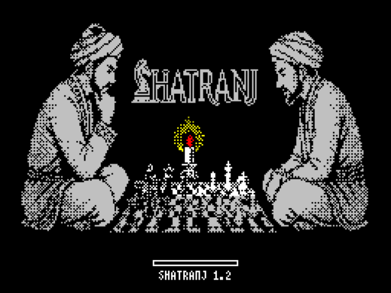<br>
  <sub>Instalador guiado del recurso para Spectranext.</sub>
</p>

Un ZIP de GitHub Releases no es un recurso montable de Spectranext; introduce
una de las direcciones HTTPS anteriores.

## Inicio rápido

1. Inicia Shatranj en ambos clientes.
2. Elige **Host** en un cliente y **Guest** en el otro.
3. Selecciona **Direct** o **MQTT** en ambos lados.
4. En Direct, introduce en el invitado la dirección y el puerto del anfitrión.
   En MQTT, introduce el mismo broker, puerto y sala en ambos clientes.
5. El anfitrión elige el color y comienza la partida. El invitado espera el
   establecimiento de la conexión y juega cuando el indicador de turno lo
   permite.
6. Usa el panel de chat o la entrada de texto del Spectrum para comunicarte
   durante la partida.

### MATCH (Spectranext)

Ambos jugadores necesitan un cartucho Spectranext con firmware 1.2 o posterior
y distintas IP públicas. En Setup, elige **LINK MATCH**. El anfitrión elige
**CREATE**, nombre y color, e inicia; aparece en la sala como `NAME (W)` o
`NAME (B)`. El rival elige **JOIN**, inicia, selecciona ese anfitrión con
ARRIBA/ABAJO y pulsa ENTER o SPACE. BREAK cancela.

MATCH empareja los cartuchos mediante el servicio del firmware y después usa
el protocolo de juego DIRECT de Shatranj. Para jugar contra Classic, Next o
Qt, selecciona DIRECT o MQTT en ambos clientes.

### Direct TCP

El anfitrión escucha en el puerto TCP configurado. Comparte su dirección y
puerto con el invitado y comprueba que el firewall y el enrutamiento permiten
la conexión. Direct no utiliza un broker MQTT.

### MQTT

Ambos clientes se conectan al mismo broker y sala. MQTT resulta útil cuando una
conexión directa entre pares no es conveniente, siempre que ambos clientes
puedan acceder al broker.

## Galería

### Novedades de la 1.4 — MATCH en Spectranext

Capturas de la release 1.4 en FuseX, con la edición para Spectranext.

<table>
  <tr>
    <td align="center" width="50%"><strong>Elige MATCH en Setup</strong><br>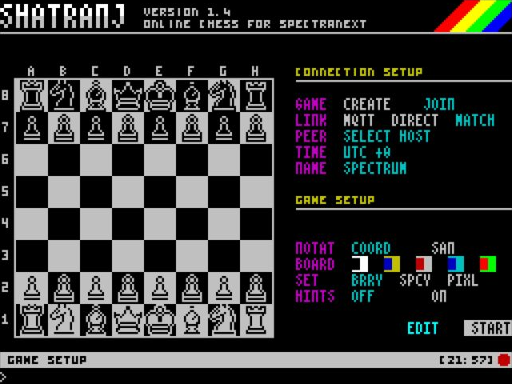</td>
    <td align="center" width="50%"><strong>Crea tu propia partida</strong><br>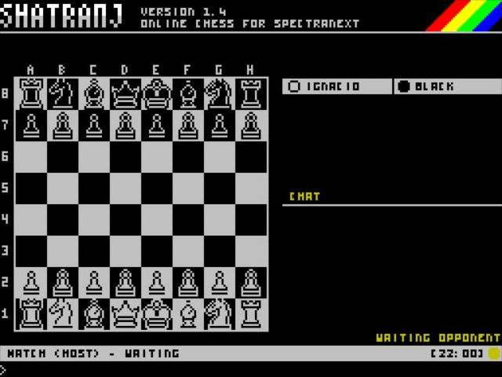</td>
  </tr>
  <tr>
    <td align="center" width="50%"><strong>Encuentra un rival esperando</strong><br>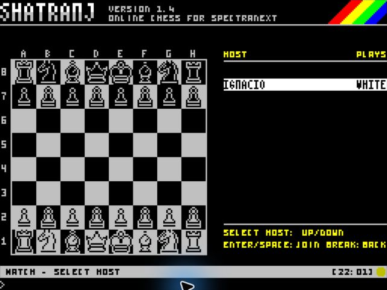</td>
    <td align="center" width="50%"><strong>Conectados y jugando</strong><br>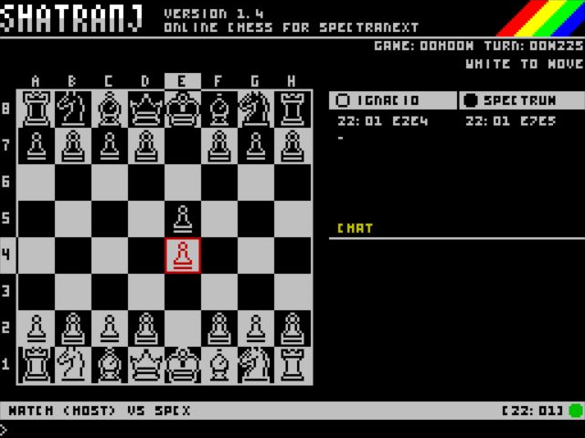</td>
  </tr>
</table>

### Novedades de la 1.3

<table>
  <tr>
    <td align="center" width="50%"><strong>Stockfish jugando por ti (macOS)</strong><br>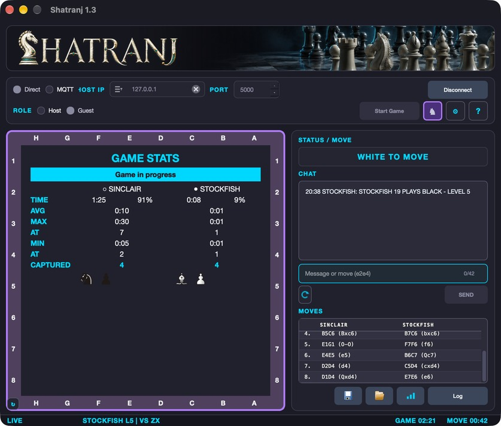</td>
    <td align="center" width="50%"><strong>Preferencias: motor Stockfish</strong><br>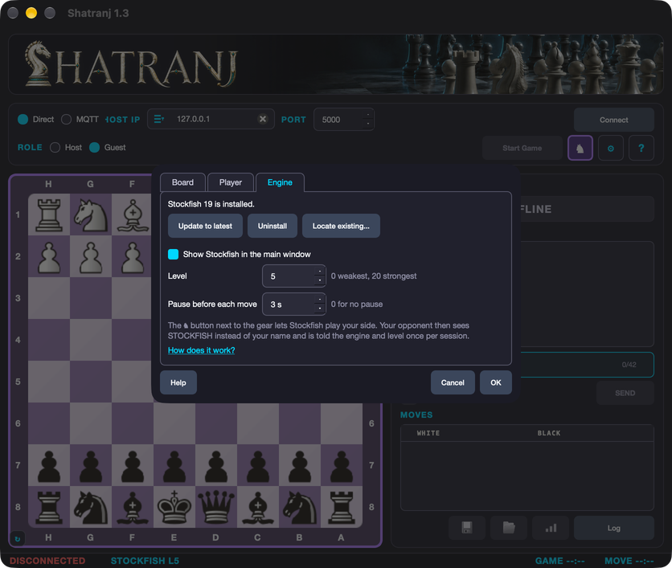</td>
  </tr>
  <tr>
    <td align="center" width="50%"><strong>Estadísticas de fin de partida</strong><br>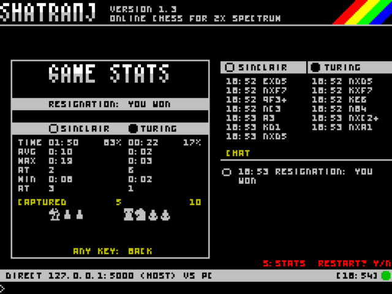</td>
    <td align="center" width="50%"><strong>Jugando contra Stockfish desde un Spectrum</strong><br>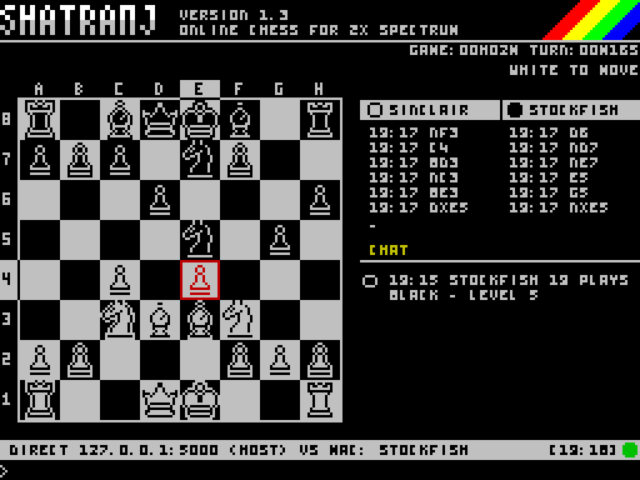</td>
  </tr>
  <tr>
    <td align="center" width="50%"><strong>Nombres de jugador y menú rotatorio</strong><br>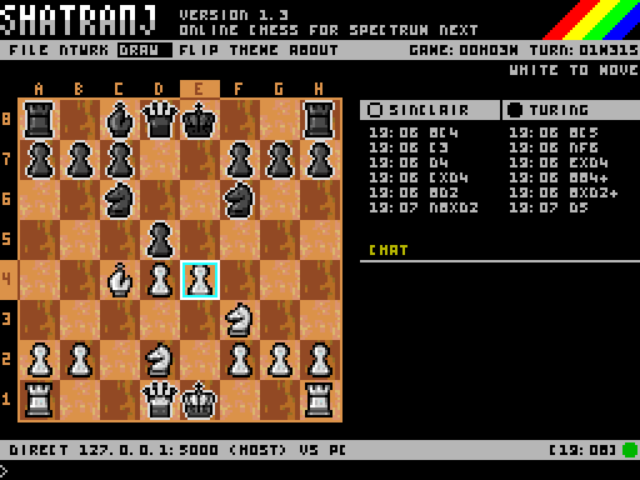</td>
    <td align="center" width="50%"><strong>Reanudar tras un corte de corriente</strong><br>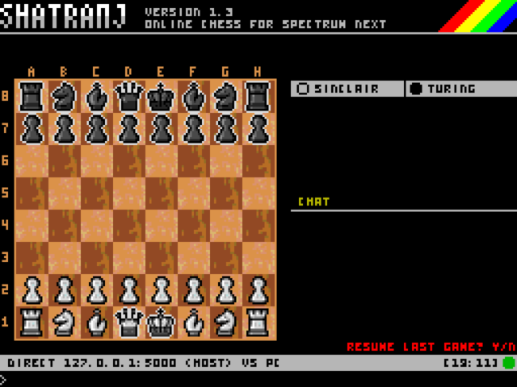</td>
  </tr>
  <tr>
    <td align="center" colspan="2"><strong>Novedades desde la pantalla Acerca de</strong><br>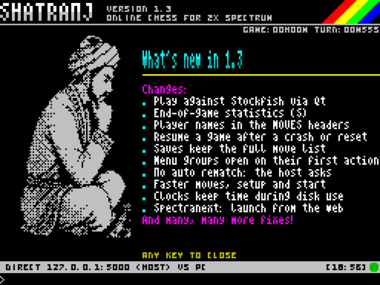</td>
  </tr>
</table>

### Escritorio

<table>
  <tr>
    <td align="center" width="50%"><strong>macOS — invitado Direct</strong><br>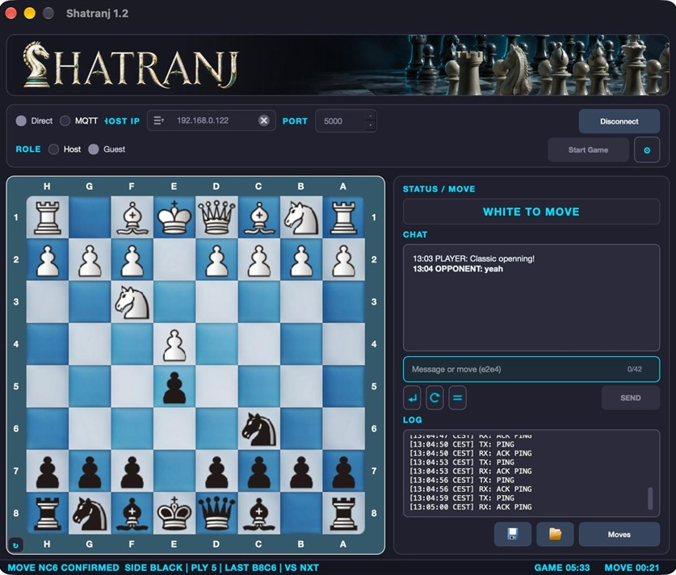</td>
    <td align="center" width="50%"><strong>Windows — partida MQTT</strong><br>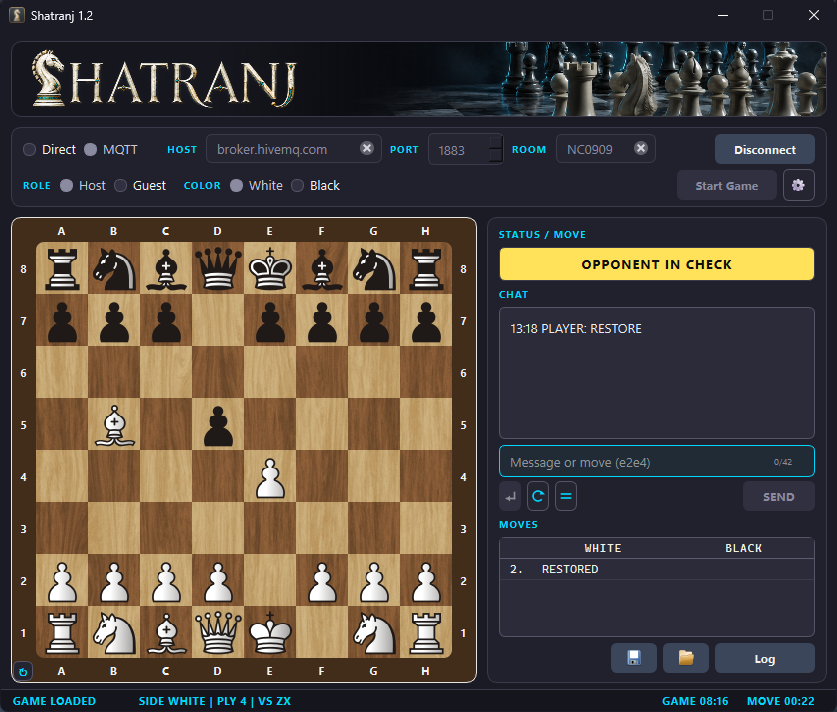</td>
  </tr>
  <tr>
    <td align="center" colspan="2"><strong>Linux — partida restaurada</strong><br>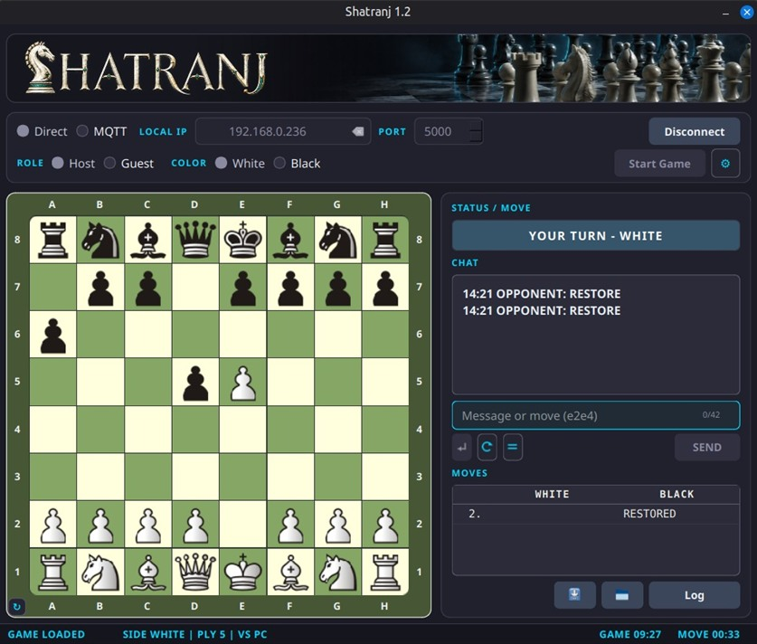</td>
  </tr>
</table>

### ZX Spectrum clásico

<table>
  <tr>
    <td align="center" width="50%"><strong>Configuración y previsualización</strong><br>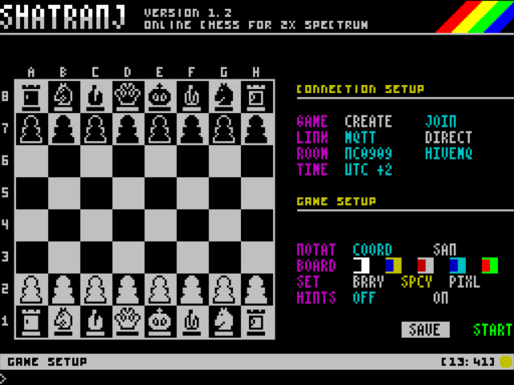</td>
    <td align="center" width="50%"><strong>Partida en red</strong><br>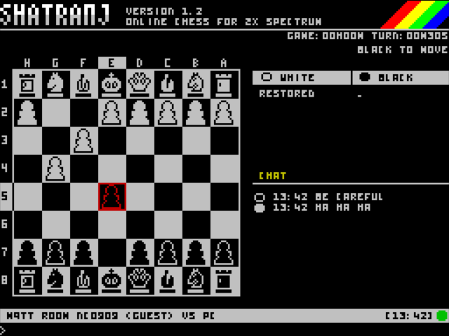</td>
  </tr>
  <tr>
    <td align="center"><strong>Acerca de</strong><br>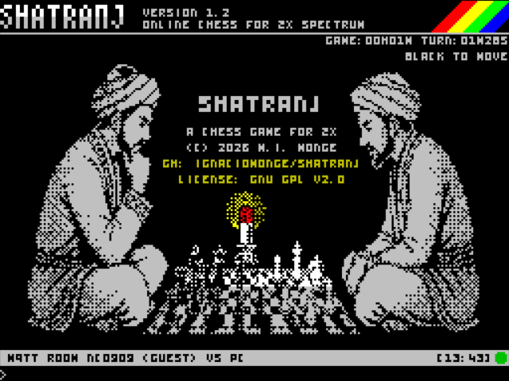</td>
    <td align="center"><strong>Tema de tablero alternativo</strong><br>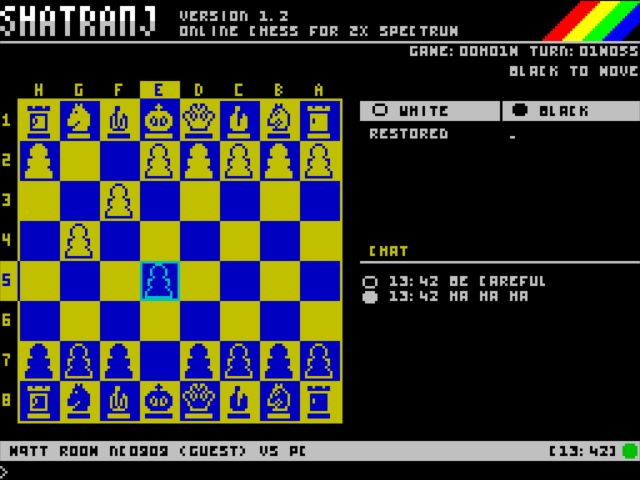</td>
  </tr>
</table>

### Spectrum Next

<table>
  <tr>
    <td align="center" width="50%"><strong>Configuración con sprites hardware</strong><br>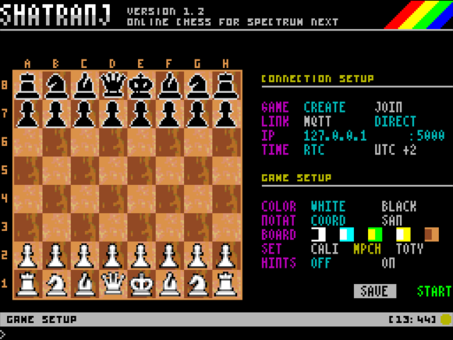</td>
    <td align="center" width="50%"><strong>Partida Direct y chat</strong><br>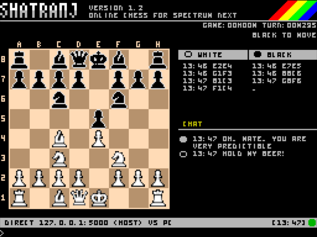</td>
  </tr>
  <tr>
    <td align="center" width="50%"><strong>Tema de tablero verde</strong><br>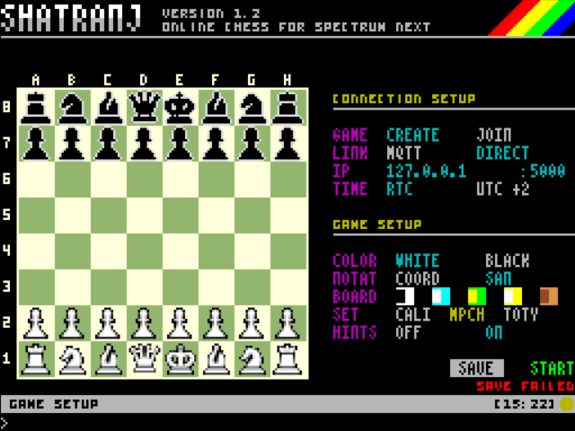</td>
    <td align="center" width="50%"><strong>Opciones durante la partida</strong><br>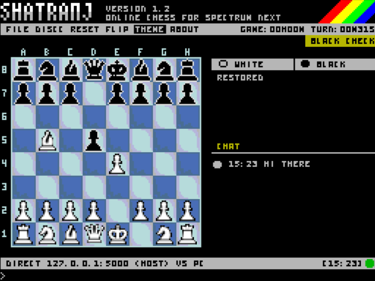</td>
  </tr>
</table>

### Spectranext

<table>
  <tr>
    <td align="center" width="50%"><strong>Ayudas de movimiento</strong><br>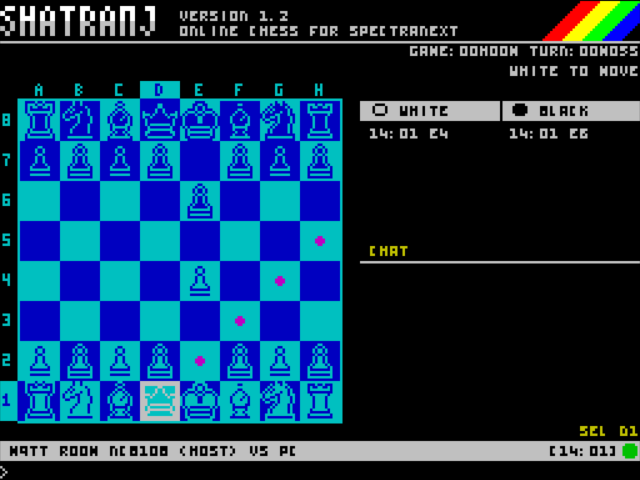</td>
    <td align="center" width="50%"><strong>Tema rojo y blanco</strong><br>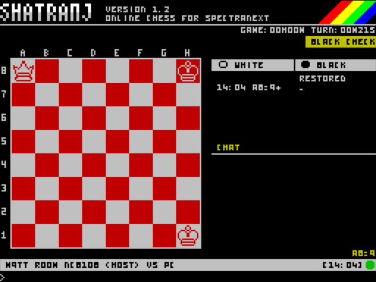</td>
  </tr>
  <tr>
    <td align="center" width="50%"><strong>Partidas guardadas</strong><br>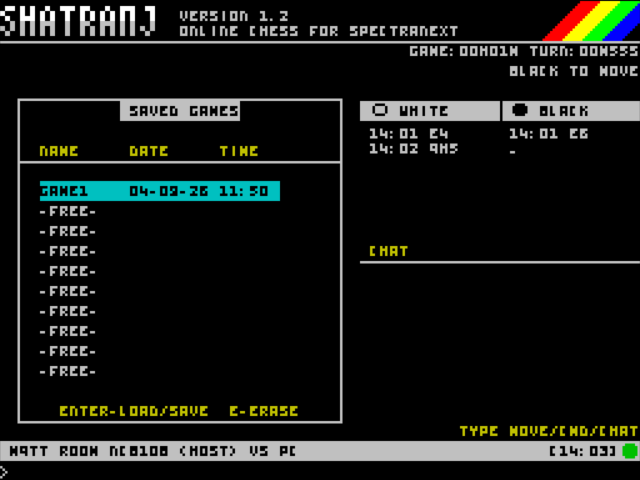</td>
    <td align="center" width="50%"><strong>Opciones durante la partida</strong><br>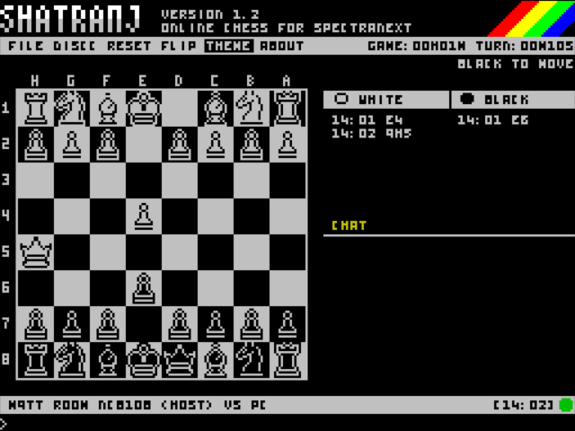</td>
  </tr>
</table>

## Juegos de piezas y temas de tablero

El tema y las piezas se eligen durante la configuración de la partida en
Spectrum.

### ZX Spectrum clásico y Spectranext

Los clientes Classic y Spectranext incluyen tres juegos de piezas de 16×16 —
**BRRY**, **SPCY** y **PIXL** — y cinco paletas: **Classic**, **Blue**,
**Green**, **Cyan** y **Magenta**.

<table>
  <tr>
    <th>Juegos de piezas</th>
    <th>Temas de tablero</th>
  </tr>
  <tr>
    <td align="center" width="34%">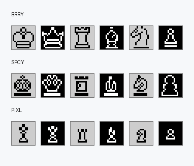</td>
    <td align="center" width="66%">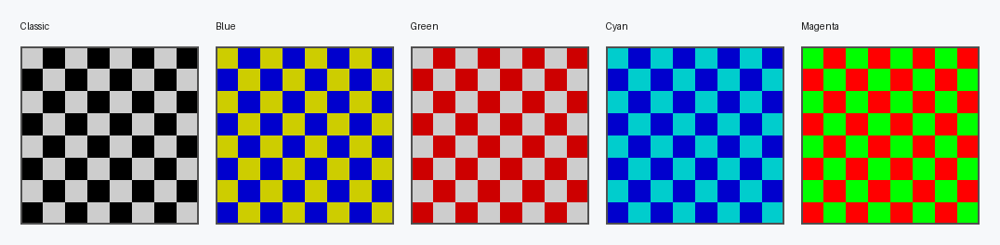</td>
  </tr>
</table>

### ZX Spectrum Next

El cliente Next utiliza sprites por hardware de 16×16 con tres juegos de piezas
derivados de Lichess — **California**, **MPChess** y **TotoY** — y cinco temas de
tablero RGB333: **Black & White**, **Blue 3**, **Green**, **Brown** y **Wood**.

<table>
  <tr>
    <th>Juegos de piezas de Next</th>
    <th>Temas de tablero de Next</th>
  </tr>
  <tr>
    <td align="center" width="36%">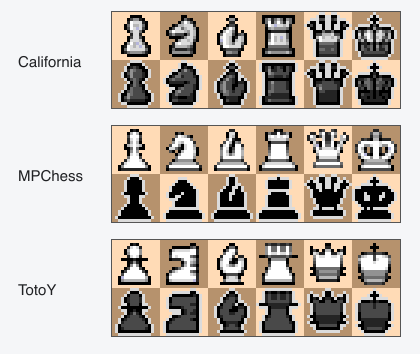</td>
    <td align="center" width="64%">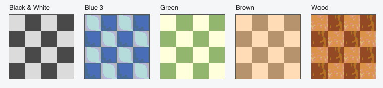</td>
  </tr>
</table>

## Uso de Shatranj

El anfitrión inicia la partida; ambos jugadores pueden solicitar tablas,
deshacer o restaurar una partida guardada compatible. Solo se aceptan
movimientos del bando cuyo turno aparece en pantalla.

Las partidas terminan sin revancha automática. Solo el anfitrión pide una
partida nueva. Spectrum muestra el resultado y, con la siguiente tecla, el
anfitrión ve `S:STATS  RESTART? Y/N` y el invitado `S:STATS  WAITING
OPPONENT`: S abre las estadísticas, cualquier tecla vuelve y la Y del
anfitrión solicita el reinicio. Rechazar la partida nueva, o BREAK, termina
la sesión para ambos. Qt ofrece **Game stats** a ambos jugadores y
**Restart Game** al anfitrión. Las estadísticas
incluyen tiempos de turnos completados y capturas; cargar una partida inicia
una muestra parcial.

### Controles de escritorio

| Acción | Control |
| --- | --- |
| Configurar una sesión | Elige Direct o MQTT, Host o Guest e introduce la dirección/puerto o el broker/sala |
| Mover una pieza | Haz clic en la casilla de origen y después en la de destino |
| Enviar texto o una jugada | Escribe en la línea de chat/entrada y pulsa Enter |
| Guardar o restaurar | Usa los botones o `/save [nombre]` y `/load [nombre]` |
| Inspeccionar el tráfico | Abre **Log** para ver los mensajes legibles RX/TX |
| Cambiar la apariencia o tu nombre | Abre **Preferences** (botón del engranaje, Ctrl+, o Cmd+,) para tablero, piezas, ayudas, nombre y Stockfish |
| Dejar que Stockfish juegue por ti | Instálalo en **Preferences > Engine** (con una pausa opcional antes de cada jugada) y pulsa el botón **♞** junto al engranaje; se vuelve violeta mientras juega Stockfish |
| Ver las estadísticas | Pulsa **Game stats** (botón de gráfico de barras) durante o después de la partida |
| Leer el manual | Pulsa **?** o F1 |

El cliente recuerda la configuración y las direcciones Direct válidas usadas
recientemente. También muestra los relojes de partida, turno y jugada.

### Controles de Spectrum

| Contexto | Control |
| --- | --- |
| Setup: cambiar de fila | Cursor arriba/abajo o `Q`/`A` |
| Setup: cambiar una opción | Cursor izquierda/derecha o `O`/`P` |
| Setup: editar o confirmar | Espacio o Enter |
| Tablero: mover el cursor | Cursores (`5`/`6`/`7`/`8`) o `Q`/`A`/`O`/`P` |
| Tablero: seleccionar origen/destino | Espacio |
| Abrir y enviar la entrada de texto | Enter |
| Abrir el menú de partida | **EDIT** (`Caps Shift` + `1` en el teclado clásico) |
| Menú FILE | `Q`/`A` elige slot; Enter/Espacio carga o guarda; `E` borra |
| Tras una partida | `S` abre las estadísticas; el anfitrión responde a `RESTART? Y/N` |
| Pantalla Acerca de | `C` muestra las novedades (Classic y Spectranext) |

El menú de partida tiene las pestañas **FILE**, **FLIP** y **ABOUT** y tres
grupos rotatorios: **NTWRK** (desconectar, reiniciar), **OFFER** (deshacer,
tablas, abandonar) y **THEME** (tablero, juego de piezas, ayudas). Usa
izquierda/derecha u `O`/`P` para elegir pestaña o grupo, arriba/abajo o
`Q`/`A` para recorrer las acciones de un grupo y después Espacio/Enter.

### Comandos de texto

| Entrada | Resultado | Disponibilidad |
| --- | --- | --- |
| `e2e4` | Enviar una jugada por coordenadas | Qt y Spectrum |
| `/draw` | Ofrecer tablas | Qt y Spectrum |
| `/resign` | Abandonar la partida | Qt y Spectrum |
| `/takeback` | Solicitar deshacer la última jugada | Qt y Spectrum |
| `/save [nombre]` | Guardar localmente la posición | Qt; usa FILE en Spectrum |
| `/load [nombre]` | Solicitar restaurar una posición guardada | Qt; usa FILE en Spectrum |

Cualquier otro texto se envía como chat. Qt solicita `q`, `r`, `b` o `n` al
promocionar; los clientes Spectrum promocionan automáticamente a dama. El
grupo OFFER del menú del Spectrum envía los mismos comandos `/takeback`,
`/draw` y `/resign`. Mientras Stockfish juega por ti, Qt rechaza esos tres:
esas decisiones son del motor.

## Compilar desde el código fuente

El punto de entrada soportado es el Makefile del repositorio:

```sh
make tap              # TAP + OVL + DAT del Spectrum clásico
make nex              # NEX autocontenido para Spectrum Next
make client-test      # compilación y pruebas de Qt
make test             # pruebas compartidas y de Spectrum en host
```

`make tap` escribe los ficheros Classic en `release/`; mantén juntos su TAP,
OVL y DAT. `make nex` escribe la imagen autocontenida de Next en
`release/Next/SHATRANJ.nex`.

## Desarrollo

Consulta la [documentación para desarrolladores](docs/README.es.md) para los
requisitos de compilación, la arquitectura, las especificaciones del protocolo
y la validación. Las instrucciones específicas del cliente de escritorio están
en la [guía de Qt](client/README.es.md).

## Créditos y licencia

- **Piezas BRRY:** basadas en [Chess Pieces 16×16 One-bit](https://berryarray.itch.io/chess-pieces-16x16-one-bit) de [BerryArray](https://berryarray.itch.io).
- **Piezas SPCY:** basadas en [Chess Pieces](https://spicygame.itch.io/chess-pieces) de [Spicy Game](https://spicygame.itch.io).
- **Piezas PIXL:** basadas en [Pixel Art Chess Pieces](https://benrosen.github.io/posts/pixel-art-chess-pieces/) de [Ben Rosen](https://benrosen.github.io).
- **Fuente Ikkle:** [Ikkle 4](https://www.dafont.com/es/ikkle-4.font) de Brixdee, base del texto compacto de Spectrum.
- El código y el arte de terceros conservan sus licencias y avisos originales.

Shatranj es software libre publicado bajo la
[GNU General Public License v2.0](LICENSE). Los términos de terceros figuran
en el [archivo de avisos](THIRD_PARTY_NOTICES.md).

## Autor

**M. Ignacio Monge Garcia — 2026**

Las incidencias y contribuciones son bienvenidas en el
[repositorio oficial](https://github.com/IgnacioMonge/shatranj).

<p align="center"><sub>Conectando el ZX Spectrum al ajedrez en línea desde 2026.</sub></p>
